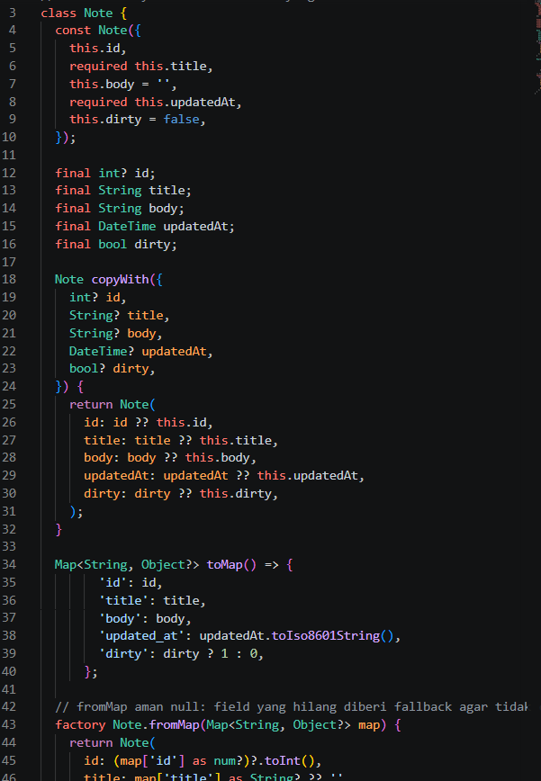
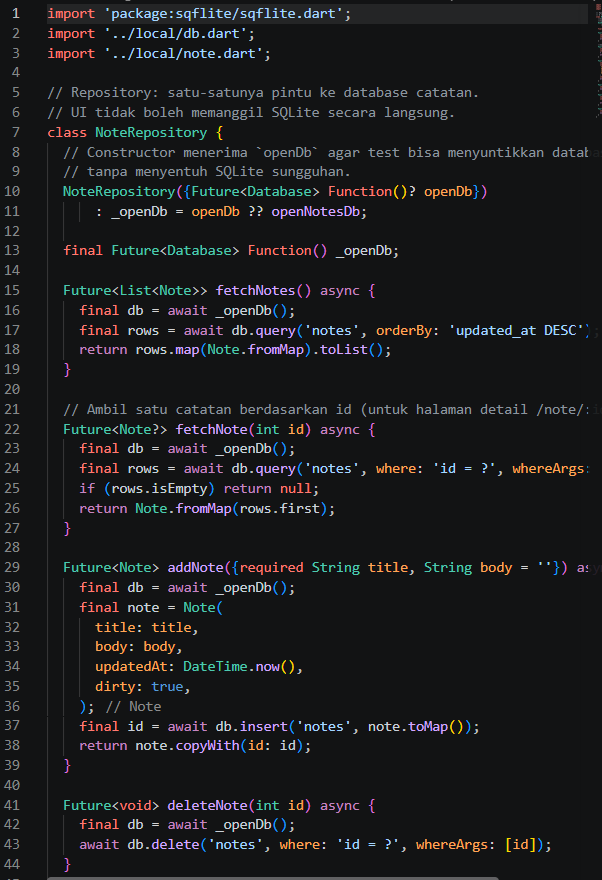
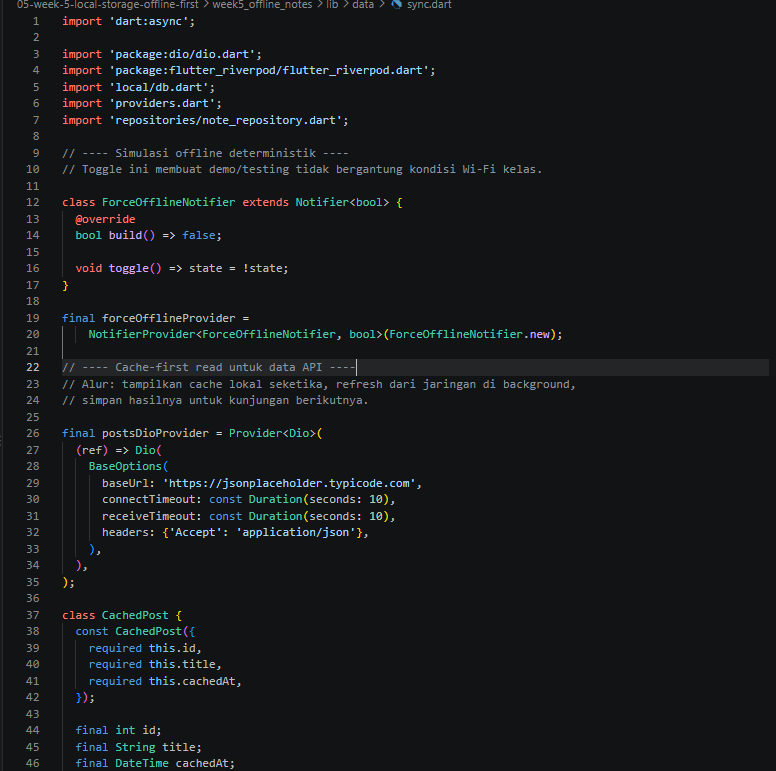

# Tujuan
- menjelaskan perbedaan penyimpanan key-value, relasional, dan NoSQL di perangkat;
- menyimpan preferensi sederhana (tema, terakhir dibuka) dengan SharedPreferences;
- menerapkan CRUD catatan dengan SQLite (sqflite) melalui repository lokal;
- menerapkan pola offline-first: cache-first read, dirty flag, dan antrean sinkronisasi;
- menampilkan state loading, error, empty, dan success untuk data lokal dengan Riverpod;
- menguji repository lokal dengan repository palsu (tanpa database sungguhan).


# Fitur Utama
### Jenis Penyimpanan Lokal
Aturan praktis memilih storage: key-value kecil pakai `SharedPreferences`, data terstruktur relasional pakai `SQLite` via `sqflite`, cache objek sederhana pakai `Hive`, dan query kompleks + stream pakai `Drift`.

|Kebutuhan     |Pilihan                 |Contoh             |
|--------------|------------------------|-------------------|
|Pengaturan kecil key-value|`SharedPreferences`|tema gelap/terang, bahasa, waktu terakhir dibuka|
|Data terstruktur relasional   |`SQLite via sqflite`|catatan, tugas, transaksi|
|NoSQL ringan embedded|`Hive`|cache objek, kotak (box) sederhana|
|Relasional reaktif & type-safe|`Drift`|aplikasi besar dengan query kompleks + stream|

Codelab ini memakai SharedPreferences + SQLite (sqflite): kombinasi paling umum di industri untuk aplikasi offline notes. Tabel perbandingan Hive vs Drift wajib Anda isi pada AI Challenge sebagai bukti pengambilan keputusan.


### Offline-first, bukan offline-only
Offline-first berarti aplikasi **selalu bisa dibaca dan ditulis** meski tanpa internet, lalu **disinkronkan** saat koneksi kembali. Tiga mekanisme intinya:

- **Cache-first read**: tampilkan data lokal seketika, lalu refresh dari jaringan di background dan simpan hasilnya.
- **Dirty flag**: setiap perubahan lokal yang belum terkirim ditandai (`dirty = 1`) agar bisa di-sync belakangan.
- **Antrean sinkronisasi**: operasi tertunda diproses berurutan saat online; konflik diselesaikan dengan aturan eksplisit (misalnya last-write-wins berdasarkan `updated_at`).
```
UI (ConsumerWidget) --watch--> Provider (AsyncValue)
Provider --panggil--> LocalRepository --CRUD--> SQLite
LocalRepository --sync--> Remote (simulasi) --sukses--> dirty = 0
Cache: baca lokal dulu, refresh background, simpan
```
### Repository untuk data lokal
Aturan arsitektur yang sama seperti Minggu 4 tetap berlaku, hanya sumber datanya berubah:

- **UI tidak boleh memanggil SQLite/SharedPreferences secara langsung**. UI hanya membaca provider.
- **Repository lokal** adalah satu-satunya pintu ke database dan preferensi. Ia mengubah exception platform menjadi kegagalan bermakna bagi UI.
- **Provider Riverpod** mengekspos AsyncValue (loading/error/data) dan fungsi invalidate untuk refresh.


# Tech Stack
- Flutter / Dart
- `flutter_riverpod` (state management, AsyncValue)
- `shared_preferences` (preferensi key-value)
- `sqflite` + `path` (database lokal SQLite)
- `dio` (cache-first read dari JSONPlaceholder)
- `go_router` (`/note/:id` halaman detail)

# Cara Menjalankan
Project berada pada folder `week5_offline_notes`.

1. Masuk ke folder project.
`cd week5_offline_notes`
2. Ambil dependency.
`flutter pub get`
3. Jalankan aplikasi (mode debug, bukan hot reload setelah menambah plugin).
`flutter run`
4. Menjalankan test.
`flutter test`
5. Cek kualitas kode.
`flutter analyze`

Catatan: `shared_preferences` dan `sqflite` adalah plugin native. Setelah
`pub get`, hentikan aplikasi lalu jalankan ulang `flutter run` (bukan hot
reload) agar tidak muncul `MissingPluginException`.

# Hasil
- Mengetahui perbedaan penyimpanan key-value, relasional, dan NoSQL di perangkat serta kapan memakai masing-masing.
- Mampu menyimpan preferensi (mode gelap, waktu terakhir dibuka) dengan SharedPreferences lewat repository.
- Mampu menerapkan CRUD catatan persisten dengan SQLite (sqflite) melalui repository lokal + Riverpod.
- Mampu menerapkan pola offline-first: cache-first read, dirty flag, dan simulasi antrean sinkronisasi.
- Mampu menampilkan state loading, error, empty, dan success untuk data lokal.
- Mampu menguji repository lokal dengan repository palsu tanpa menyentuh database sungguhan.
- `flutter analyze` tanpa issue dan `flutter test` semua lulus (5 test).

# Tugas (Mini Project / Industry Challenge)
Bangun **aplikasi Offline Notes** sebagai tugas minggu ini. Implementasi ada pada project `week5_offline_notes`.

1. [x] Preferensi: toggle tema gelap/terang + waktu terakhir dibuka via SharedPreferences (`lib/data/prefs.dart`, `lib/pages/settings_page.dart`).
2. [x] CRUD catatan persisten via SQLite melalui repository lokal + Riverpod, diurutkan `updated_at` terbaru (`lib/data/repositories/note_repository.dart`, `db.dart`, `providers.dart`).
3. [x] Offline-first: cache-first untuk data bacaan (`cached_posts`), dirty flag + `syncNotes` untuk tulisan, aturan konflik **last-write-wins** berdasarkan `updated_at` (`lib/data/sync.dart`).
4. [x] Simulasi offline deterministik dengan toggle **Force offline** (tidak bergantung mode pesawat); bukti ada pada bagian Screenshot.
5. [x] Minimal 2 test lulus (1 unit test model + 1 test provider dengan repository palsu) — total 5 test.
6. [x] AI Challenge dikerjakan dan didokumentasikan di `docs/ai-challenge-storage.md`.
7. [x] Struktur `lib/`, `test/`, `docs/`, `README.md`, dan `screenshots/`.

Refactoring Challenge:
- Baris catatan dipisah menjadi widget `NoteTile` (`lib/widgets/note_tile.dart`) yang menampilkan badge "belum tersinkron" bila `dirty == true`.
- Logika cache posts dan `syncNotes` dipindah ke `lib/data/sync.dart` agar repository tetap fokus pada CRUD.
- Halaman detail catatan dengan GoRouter (`/note/:id`) yang membaca dari repository lokal, bukan dari state halaman list.

# AI Challenge
Prompt, tabel perbandingan SharedPreferences vs Hive vs sqflite vs Drift, rekomendasi final, skema tabel untuk 1000+ catatan, dan temuan verifikasi ada di `docs/ai-challenge-storage.md`.

Ringkasan keputusan:
| Kebutuhan | Pilihan | Alasan |
|---|---|---|
| Preferensi tema + waktu terakhir dibuka | SharedPreferences | Nilai primitif kecil, tanpa query/relasi |
| CRUD catatan (1000+ baris) | sqflite (SQLite) | Butuh order, filter `dirty`, dan update massal |

Drift ditolak karena boilerplate `build_runner` tidak sebanding untuk kebutuhan query sesederhana ini; Hive ditolak karena data catatan bersifat relasional/terstruktur sehingga SQL lebih tepat.

# Checklist Verifikasi Mandiri
- [x] UI tidak memanggil SQLite/SharedPreferences langsung; semua lewat repository + provider.
- [x] Aplikasi berfungsi dalam mode offline: baca, tambah, hapus catatan (SQLite lokal).
- [x] Badge dirty akurat sebelum/sesudah sync; cache posts tampil tanpa internet (toggle Force offline).
- [x] `flutter analyze` tanpa issue dan semua test lulus (5 test).
- [x] Hasil AI diverifikasi dan didokumentasikan di `docs/`.

# Refleksi
- **Mengapa daftar catatan tidak boleh disimpan di SharedPreferences? Apa yang rusak jika aturan ini dilanggar?** SharedPreferences hanya untuk nilai primitif kecil. Menyimpan daftar catatan sebagai satu string JSON membuat query (urut, filter `dirty`), update parsial, dan sinkronisasi menjadi rapuh: setiap perubahan harus menulis ulang seluruh string, rawan konflik, dan lambat saat data membesar.

- **Kapan cache-first cukup, dan kapan butuh strategi lain (misalnya network-first untuk data harga real-time)?** Cache-first cukup untuk data yang jarang berubah dan toleran terhadap data agak lama (daftar posts, pengumuman). Untuk data yang harus selalu baru seperti harga saham atau saldo, gunakan network-first (atau cache hanya sebagai fallback saat offline) agar pengguna tidak melihat nilai kedaluwarsa.

- **Bagaimana dirty flag berubah menjadi antrean sync tanpa memblokir UI? Kapan antrean terpisah (tabel outbox) menjadi perlu?** Setiap perubahan lokal menandai `dirty = 1` tanpa menunggu jaringan; `syncNotes` membaca `countDirty` lalu mengunggah dan memanggil `markAllSynced` di belakang layar (di sini disimulasikan delay 1 detik). Tabel `outbox` terpisah menjadi perlu ketika urutan operasi penting (create lalu update lalu delete pada record yang sama), saat ada operasi yang butuh retry/backoff, atau ketika satu user mengubah data dari beberapa perangkat.

- **Bagian mana dari rekomendasi AI yang Anda tolak, dan mengapa?** Saran memakai Drift (atau Hive untuk semuanya) saya tolak karena menambah boilerplate/complexity tanpa manfaat nyata: kebutuhan query di sini hanya order + filter `dirty`, sementara Drift menuntut `build_runner` dan migrasi, dan Hive tidak nyaman untuk query terurut/relasional. Kombinasi SharedPreferences + sqflite lebih ringkas, mudah diuji, dan sesuai industri.

# Referensi
- [Slide Week 5: Local Storage & Offline First](../00-slides/Week_05_Local_Storage_Offline_First.html)
- Flutter cookbook: [Store key-value data](https://docs.flutter.dev/cookbook/persistence/key-value)
- [shared_preferences package](https://pub.dev/packages/shared_preferences)
- [sqflite package](https://pub.dev/packages/sqflite)
- [Hive package (alternatif NoSQL)](https://pub.dev/packages/hive)
- [Drift package (alternatif reaktif)](https://pub.dev/packages/drift)
- Riverpod: [AsyncNotifier dan AsyncValue](https://riverpod.dev/docs/concepts/async_notifiers)
- [Learn Dart in Y Minutes](https://learnxinyminutes.com/dart/)

# Screenshot
## Daftar Catatan (offline-first)

Daftar catatan + badge dirty (2 catatan belum tersinkron)


Daftar kosong (empty state)


Error state + tombol "Coba lagi"


## Detail & Pengaturan

Detail catatan (`/note/:id`)


Pengaturan mode gelap + waktu terakhir dibuka


## Kode

Kode model Note dan pembuka database


Kode repository dan provider


Kode sync (cache-first + dirty flag)


Kode unit test


Bukti `flutter analyze` dan `flutter test`


