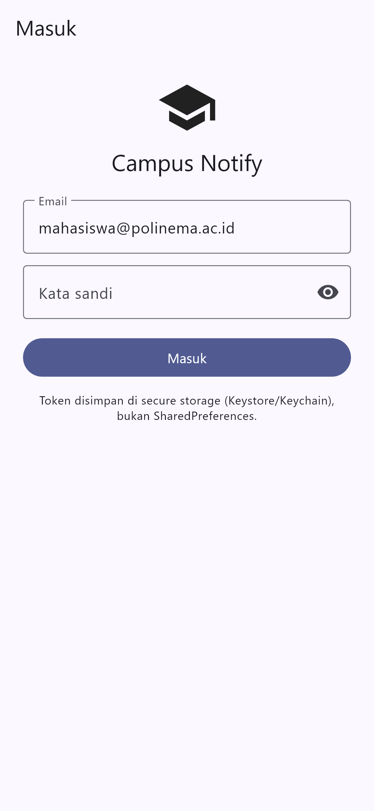
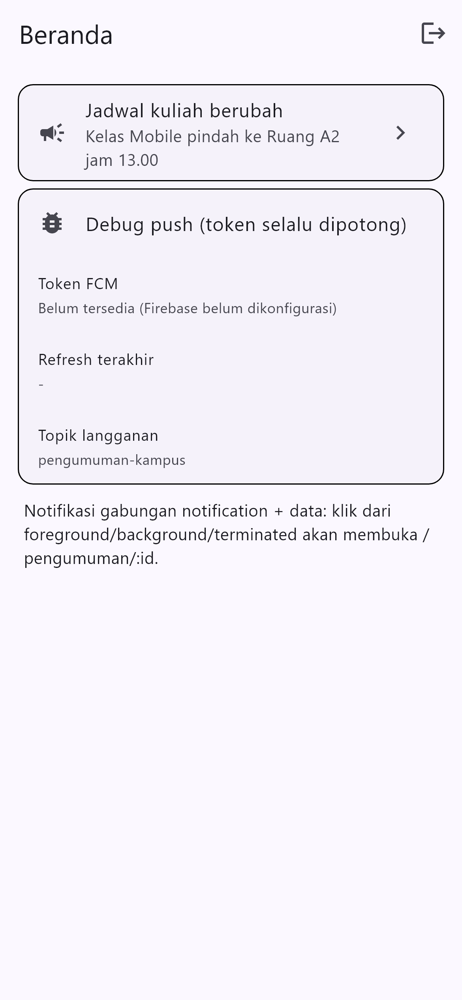
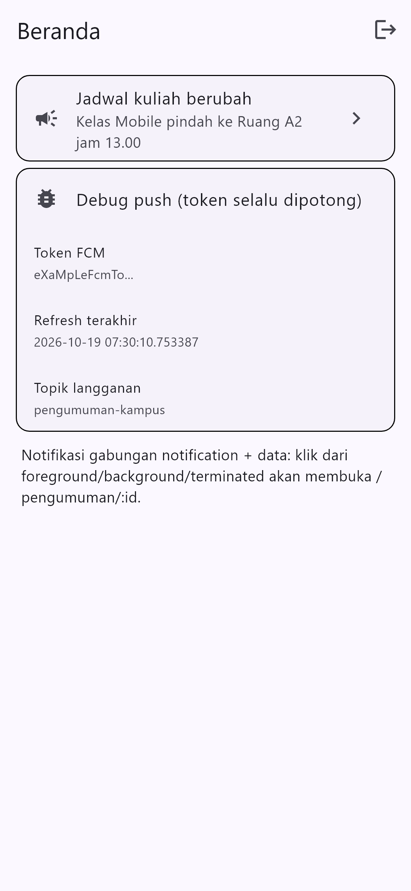
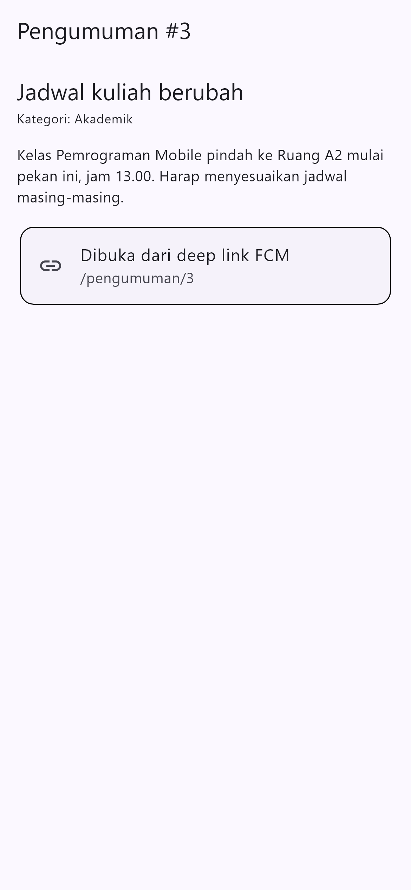

# Tujuan
- menjelaskan alur autentikasi (Firebase Auth / JWT / OAuth / Google Login) dan perbedaan ID token vs access token vs refresh token;
- menyimpan token secara aman dengan secure storage serta menerapkan token refresh otomatis;
- menjelaskan arsitektur FCM: app server, Firebase, dan perangkat;
- meminta notification permission dan mengelola token lifecycle (`getToken`, `onTokenRefresh`);
- membedakan notification payload vs data payload serta perilakunya pada state foreground, background, dan terminated;
- menangani klik notifikasi (deep link dengan GoRouter) dan topic messaging;
- menerapkan prinsip keamanan dasar aplikasi mobile (tidak menyimpan secret di kode, tidak log token).


# Fitur Utama
### Model autentikasi
Tiga pola login yang umum di industri:

|Pola     |Cara kerja singkat                 |Kapan dipakai             |
|---------|-----------------------------------|--------------------------|
|`Firebase Auth` (email/Google)|SDK Firebase menukar kredensial menjadi ID token JWT yang diverifikasi backend|Aplikasi kampus yang butuh login cepat tanpa membangun server auth sendiri|
|`JWT + refresh token` (REST API sendiri)|Server menerbitkan access token berumur pendek + refresh token berumur panjang|Backend kampus milik sendiri|
|`OAuth (Google Login)`|Aplikasi mendapat authorization code, ditukar menjadi token via provider|Login sosial / SSO kampus|

Codelab ini memakai **mock auth provider + JWT simulasi** agar bisa berjalan tanpa backend, lalu menunjukkan titik di mana Firebase Auth dipasang. Pola repository dan token refresh-nya identik, sehingga migrasi ke Firebase Auth hanya mengganti sumber token.

### Token: ID token, access token, refresh token
- **ID token:** bukti identitas pengguna (siapa dia). Diverifikasi backend setiap request yang butuh identitas.
- **Access token:** izin akses berumur pendek (misalnya 15 menit), dikirim sebagai `Authorization: Bearer ...`.
- **Refresh token:** tiket berumur panjang untuk meminta access token baru tanpa login ulang. **Hanya disimpan di secure storage, tidak pernah di SharedPreferences.**

```
Login --> access (15 mnt) + refresh (7 hari) tersimpan aman
Request API --header Bearer access--> 401 expired?
Ya --> tukar refresh --> access baru --> ulangi request sekali
Refresh ikut kedaluwarsa --> logout, kembali ke /login
```

### Arsitektur FCM
```
App Server (backend) --kirim ke--> Firebase Cloud Messaging
FCM --push--> Perangkat Android / iOS
Aplikasi --daftar token--> Backend (simpan token per user)
```
Alur wajibnya: (1) aplikasi meminta izin notifikasi, (2) aplikasi mengambil **registration token** via `FirebaseMessaging.instance.getToken()`, (3) token dikirim ke backend dan disimpan per user, (4) backend memanggil FCM API untuk mengirim pesan ke token/topik tertentu.

### Notification payload vs data payload
|Jenis     |Isi                 |Perilaku sistem             |
|----------|--------------------|----------------------------|
|`notification`|`title` + `body` tampilan|Android menampilkan otomatis saat background/terminated; foreground butuh tampil manual|
|`data`|key-value bebas, mis. `{route: /pengumuman/3}`|Selalu diteruskan ke handler aplikasi; tidak ditampilkan otomatis|

Aturan praktis **Campus Notification App**: selalu kirim gabungan `notification + data`. `notification` untuk teks yang dibaca manusia, `data.route` untuk deep link tujuan klik.

### Tiga app state yang wajib diuji
|State     |Arti                 |Handler yang bekerja             |
|----------|---------------------|---------------------------------|
|Foreground|Aplikasi terbuka     |`FirebaseMessaging.onMessage` (tampilkan manual via local notification)|
|Background|Aplikasi diminimize  |Banner sistem otomatis + `onMessageOpenedApp` saat diklik|
|Terminated|Aplikasi dimatikan   |`getInitialMessage()` saat dibuka dari notifikasi|

### Topic vs token perangkat
- **Topik** untuk broadcast: semua mahasiswa, satu kelas, satu UKM (nama topik tanpa spasi, mis. `pengumuman-kampus`).
- **Token perangkat** untuk pesan personal: nilai, tagihan, atau pesan yang hanya untuk satu pengguna.

### Prinsip keamanan dasar
Jangan pernah: menyimpan token/secret di SharedPreferences atau hardcode di Dart, mencetak token ke log production, atau mengirim refresh token lewat query URL. Refresh token hanya lewat body POST HTTPS dan disimpan di `flutter_secure_storage` (Keychain/Keystore).


# Tech Stack
- Flutter / Dart
- `flutter_riverpod` (state management)
- `go_router` (guard route + deep link)
- `dio` (API client dengan interceptor refresh 401)
- `flutter_secure_storage` (penyimpanan token)
- `firebase_core`, `firebase_messaging` (FCM)
- `flutter_local_notifications` (banner foreground manual)


# Cara Menjalankan
Project berada pada folder `campus_notify`.

1. Masuk ke folder project.
`cd campus_notify`
2. Ambil dependency.
`flutter pub get`
3. Daftarkan aplikasi ke Firebase Console (lihat langkah di bawah).
4. Jalankan aplikasi di perangkat fisik (notifikasi paling mudah diuji di device, bukan emulator tanpa Google Play Services).
`flutter run`

Setup Firebase:
1. Buat project di [Firebase Console](https://console.firebase.google.com/), tambahkan aplikasi Android sesuai `applicationId`.
2. Unduh `google-services.json` ke `android/app/`, terapkan plugin `google-services` dan dependensinya.
3. Untuk iOS tambahkan `GoogleService-Info.plist`.
4. Pastikan `firebase_core` diinisialisasi sebelum `runApp`: `await Firebase.initializeApp()`.

Menjalankan test:
`flutter test`
`flutter analyze`

Catatan: setelah menambah plugin native (secure storage, messaging, local notification), hentikan aplikasi lalu jalankan ulang `flutter run` (bukan hot reload) agar tidak `MissingPluginException`.


# Hasil
- Mengetahui alur autentikasi (Firebase Auth / JWT / OAuth) dan perbedaan ID token, access token, dan refresh token.
- Mampu menyimpan token di `flutter_secure_storage` dan menerapkan refresh otomatis sekali saat 401 lalu logout bila refresh mati.
- Mengetahui arsitektur FCM dan alur pendaftaran token perangkat ke backend.
- Mampu meminta notification permission dan mengelola token lifecycle (`getToken`, `onTokenRefresh`).
- Mampu membedakan notification payload vs data payload dan perilakunya di foreground/background/terminated.
- Mampu menangani klik notifikasi sebagai deep link dengan GoRouter dan menerapkan topic messaging.
- Menerapkan prinsip keamanan dasar: tidak hardcode secret, tidak log token, token tidak di query URL.

# Tugas (Mini Project / Industry Challenge)
Bangun **Campus Notification App** pada project `campus_notify`.

1. [x] Login (mock/Firebase Auth) dengan guard route: belum login selalu diarahkan ke `/login` (`lib/router.dart` + `authStateProvider`).
2. [x] Token disimpan di secure storage; Dio otomatis refresh sekali saat 401 dan logout bila refresh mati (`lib/data/token_store.dart`, `lib/data/api_client.dart`).
3. [x] FCM terintegrasi di kode: permission, token dikirim ke `POST /devices` (simulasi), dan subscribe topik `pengumuman-kampus` (`lib/messaging/push_service.dart`). Aktif setelah `google-services.json` dipasang (lihat `docs/firebase-setup.md`).
4. [ ] Notifikasi gabungan `notification + data` dibuktikan di perangkat untuk ketiga app state (kode deep link sudah siap; tabel di bawah menunggu hasil uji device).
5. [ ] Screenshot banner tiap state + halaman tujuan deep link — 4 screenshot UI sudah ada, sisanya butuh HP fisik.
6. [x] Minimal 2 test lulus — total **8 test** lulus (parsing route + logika sesi/refresh + token store).
7. [x] AI Challenge dikerjakan dan didokumentasikan di `docs/ai-challenge-push-service.md`.
8. [x] Struktur `lib/`, `test/`, `docs/`, `README.md`, dan `screenshots/` di folder `06-week-6-authentication-security-fcm/`.

Catatan versi: `firebase_messaging` 17 sudah men-deprecate `getToken()`/`onTokenRefresh`, jadi kode memakai `register()` + `onRegistered` (dan `onUnregistered`). Pola kirim token ke backend tetap sama. Detail: `docs/ai-challenge-push-service.md`.

## Tabel Pengujian Tiga App State
Wajib diisi setelah pengujian di perangkat.

|State     |Yang diharapkan             |Cara uji             |Hasil             |
|----------|----------------------------|---------------------|------------------|
|Foreground|Banner lokal muncul, klik masuk ke `/pengumuman/3`|Aplikasi terbuka, kirim dari console/backend| |
|Background|Banner sistem muncul, klik masuk ke rute yang benar|Tekan Home, kirim, klik banner| |
|Terminated|Aplikasi terbuka ke rute yang benar via `getInitialMessage`|Swipe-close aplikasi, kirim, klik banner| |

Struktur folder project:
```
lib/
├── main.dart
├── routes.dart
├── data/
│   ├── auth_repository.dart
│   ├── token_store.dart
│   └── api_client.dart
├── providers/
│   └── auth_provider.dart
├── messaging/
│   └── push_service.dart
└── pages/
    ├── login_page.dart
    ├── home_page.dart
    └── announcement_page.dart
```


# AI Challenge
## Prompt yang Digunakan
    Aplikasi Flutter Campus Notification App.
    Stack: firebase_messaging, flutter_local_notifications,
    flutter_secure_storage, go_router, Riverpod.
    Buatkan PushService dengan:
    - requestPermission + getToken + onTokenRefresh (kirim ke POST /devices)
    - onMessage (tampilkan local notification manual)
    - onMessageOpenedApp + getInitialMessage (navigasi ke data.route)
    - subscribe/unsubscribe topic pengumuman-kampus
    - background handler top-level dengan @pragma('vm:entry-point')
    Tandai bagian yang BERBEDA untuk Android 13+ vs iOS,
    dan bagian yang tidak boleh mengakses BuildContext.

## AI Verification Checklist
- [x] Background handler berupa fungsi top-level dengan `@pragma('vm:entry-point')` (bukan method kelas).
- [x] Token baru benar-benar dikirim ke backend (`register()` + `onRegistered` → `POST /devices`), bukan hanya dicetak ke log.
- [x] Foreground memakai local notification manual (tanpa ini banner tidak muncul saat aplikasi terbuka).
- [ ] Klik dari ketiga state (foreground/background/terminated) masuk ke rute yang benar — bukti tabel pengujian di perangkat.
- [x] Token/secret tidak di-hardcode dan selalu ditampilkan terpotong (`maskToken`, `maskForLog`).
- [x] Keputusan final dan alasan teknis didokumentasikan (boleh berbeda dari saran AI selama berargumen).

Tanggung jawab teknis: prompt, daftar perbaikan manual, dan tabel hasil uji tiga app state disimpan di `docs/ai-challenge-push-service.md` dan `docs/pengujian.md`.


# Refactoring Challenge
1. [x] Pindahkan semua string rute (`/login`, `/pengumuman/:id`) ke satu file `lib/routes.dart` agar deep link dari FCM dan GoRouter memakai konstanta yang sama (`AppRoutes` + `AppRoutes.announcement(id)`).
2. [x] Ekstrak parsing `RemoteMessage -> route` ke fungsi murni `routeFromMessage(Map<String, dynamic> data)` agar bisa diunit-test tanpa Firebase (ada 2 unit test-nya).
3. [x] Pindahkan pemetaan `DioException -> pesan ramah pengguna` (401, timeout, offline) ke `lib/data/api_errors.dart` agar UI hanya menerima pesan, bukan exception mentah.

# Dokumentasi Tambahan
- `docs/firebase-setup.md` — langkah setup Firebase Console + Gradle + uji kirim notifikasi + troubleshooting.
- `docs/ai-challenge-push-service.md` — prompt, hasil AI, perbaikan manual, keputusan teknis, checklist verifikasi.
- `docs/pengujian.md` — hasil `flutter analyze`/`flutter test`, matriks uji tiga app state, dan daftar uji yang butuh perangkat.


# Checklist Verifikasi Mandiri
- [x] Token hanya di `flutter_secure_storage`, tidak di SharedPreferences/log/screenshot penuh (token selalu dipotong dengan `maskToken`/`maskForLog`).
- [x] 401 memicu refresh sekali lalu retry; refresh mati memaksa login ulang (`lib/data/api_client.dart`).
- [ ] Ketiga app state teruji dengan tabel bukti; klik masuk ke rute yang benar (butuh perangkat + Firebase).
- [x] Topik untuk broadcast (`pengumuman-kampus`), token untuk pesan personal.
- [x] `flutter analyze` bersih dan semua test lulus (8 test).
- [x] Hasil AI diverifikasi dan didokumentasikan pada folder `docs/`.


# Refleksi
- **Mengapa refresh token tidak boleh disimpan di SharedPreferences? Apa risikonya bila bocor?** SharedPreferences menyimpan data sebagai file XML/plist biasa **tanpa enkripsi**, sehingga pada perangkat yang di-root/jailbreak atau lewat backup, isinya bisa dibaca pihak lain. Refresh token adalah tiket berumur panjang untuk menerbitkan access token baru tanpa login ulang; bila bocor, penyerang bisa terus mengakses akun pengguna meski access token sudah kedaluwarsa, dan korbannya mungkin tidak sadar. Karena itu token hanya boleh disimpan di `flutter_secure_storage` yang memakai Keystore (Android) / Keychain (iOS).

- **Apa yang rusak bila token refresh diabaikan selama satu semester perkuliahan?** Backend akan menyimpan token basi. FCM me-rotate token saat aplikasi di-reinstall, data dibersihkan, atau karena alasan keamanan, sehingga pesan berikutnya dikirim ke token lama dan **tidak pernah sampai** ke perangkat. Gejalanya sulit didiagnosis karena aplikasi tidak error, hanya notifikasi yang "kadang hilang" untuk sebagian pengguna. (Di `firebase_messaging` 17+, peran `onTokenRefresh` digantikan oleh stream `onRegistered`.)

- **Kapan memakai topik dan kapan memakai token perangkat? Beri contoh pesan kampus untuk masing-masing.** Topik untuk broadcast ke banyak pengguna sekaligus: pengumuman jadwal kuliah, info libur nasional, atau pengumuman satu UKM. Token perangkat untuk pesan personal yang hanya boleh dibaca satu orang: nilai KHS, tagihan UKT, atau pengingat bimbingan atas nama satu mahasiswa. Aturan praktisnya: kalau isi pesan berbeda per orang, jangan pakai topik.

- **Bagian mana dari draf AI yang Anda tolak atau perbaiki, dan mengapa?** Draf AI perlu diverifikasi pada: (1) background handler harus fungsi top-level dengan `@pragma('vm:entry-point')`, karena dieksekusi di isolate terpisah dan tidak boleh mengakses `BuildContext`/Riverpod; (2) `onTokenRefresh` harus benar-benar mengirim token ke backend, bukan sekadar `print`; dan (3) banner foreground harus ditampilkan manual lewat `flutter_local_notifications` karena sistem tidak menampilkannya otomatis. Bagian yang melanggar prinsip keamanan (menampilkan token penuh di log/screenshot) saya perbaiki dengan memotong token.


# Referensi
- [Slide Week 6: Authentication, Security & FCM](../00-slides/Week_06_Authentication_Security_FCM.html)
- [FCM Flutter client (setup & token)](https://firebase.google.com/docs/cloud-messaging/flutter/client)
- [FCM message types: notification vs data](https://firebase.google.com/docs/cloud-messaging/concept-options)
- [Firebase Auth for Flutter](https://firebase.google.com/docs/auth/flutter/start)
- [flutter_secure_storage package](https://pub.dev/packages/flutter_secure_storage)
- [flutter_local_notifications package](https://pub.dev/packages/flutter_local_notifications)
- [GoRouter: redirect & deep linking](https://go_router.dev/)
- [OWASP Mobile Top 10](https://owasp.org/www-project-mobile-top-10/)
- [Learn Dart in Y Minutes](https://learnxinyminutes.com/dart/)


# Screenshot

> Ditandai **[ADA]** = sudah tersedia (digenerate otomatis lewat widget/golden test).
> Ditandai **[HP]** = masih perlu kamu ambil di perangkat fisik (butuh Firebase + notifikasi nyata).

## Login & Guard Route

Guard route: belum login diarahkan ke `/login` (halaman masuk + validasi email/sandi) — **[ADA]**


## Beranda & Token Aman

Beranda sebelum Firebase dikonfigurasi (token belum tersedia) — **[ADA]**


Token FCM ditampilkan terpotong di kartu Debug push — **[ADA]**


## Deep Link

Halaman tujuan deep link `/pengumuman/3` — **[ADA]**


## FCM Tiga App State — **[HP]**

Foreground: banner lokal muncul


Background: banner sistem + klik masuk deep link


Terminated: aplikasi terbuka ke `/pengumuman/3`


Uji kirim dari Firebase Console (notification + data `route`)


Bukti `onRegistered` mengirim token baru setelah reinstall/clear data — **[HP]**


## Kode & Verifikasi — **[HP]**

Kode `token_store.dart` dan `api_client.dart` (refresh 401)


Kode `push_service.dart`


Kode unit test


Bukti `flutter analyze` dan `flutter test`

