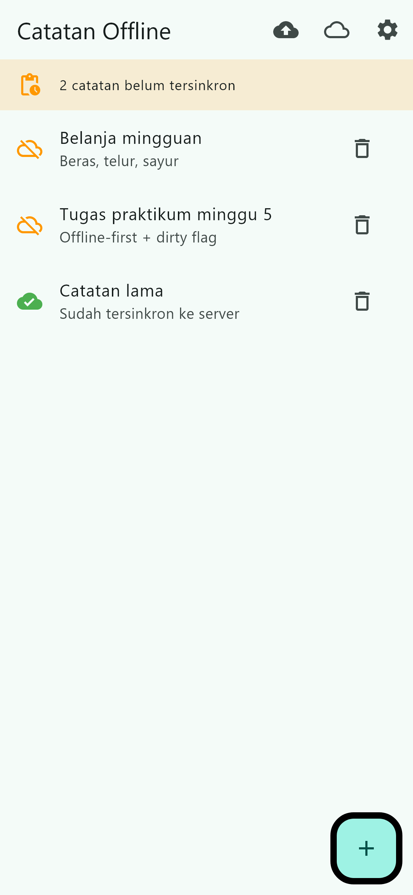
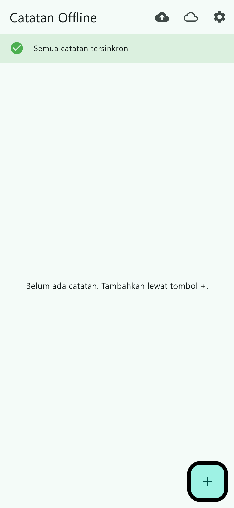
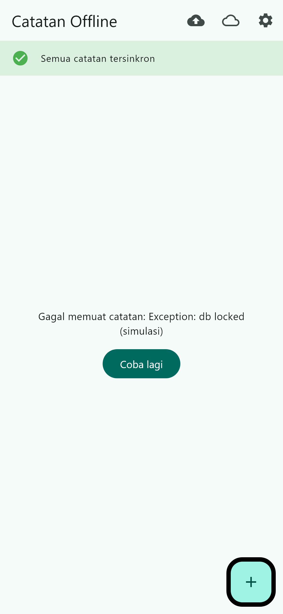
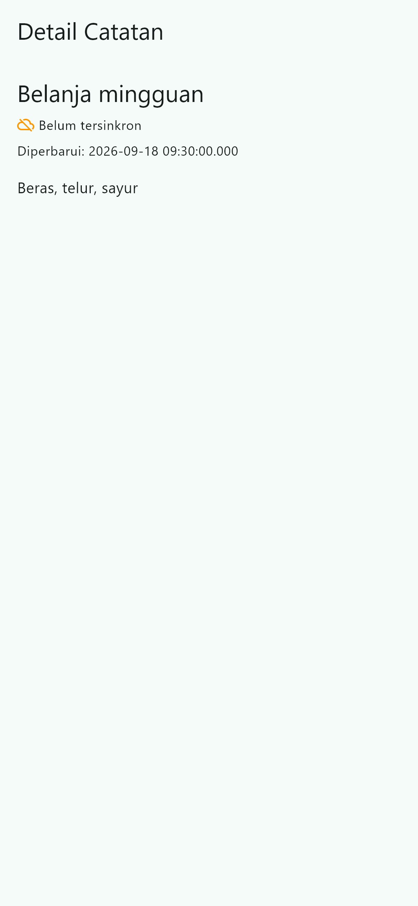
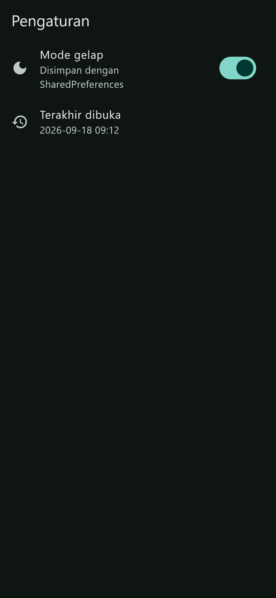
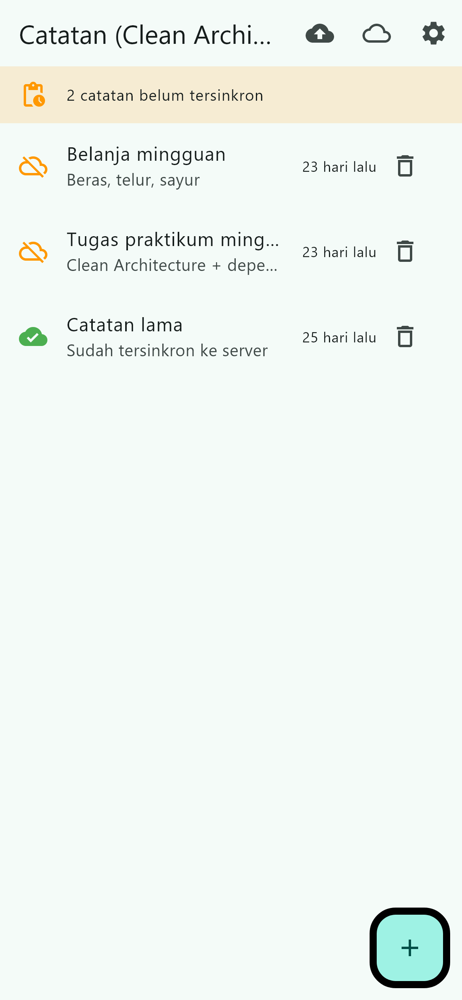
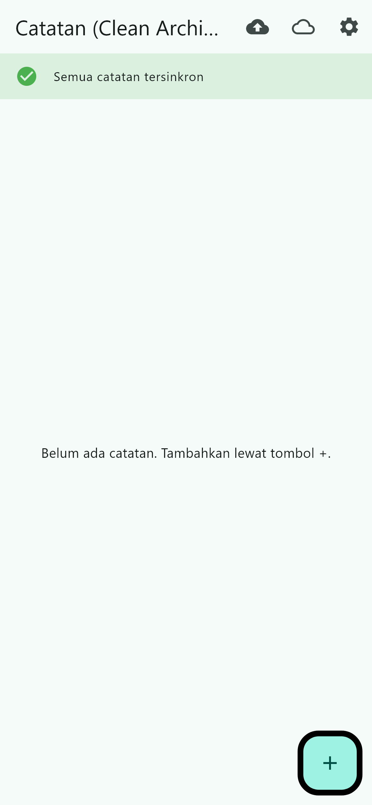
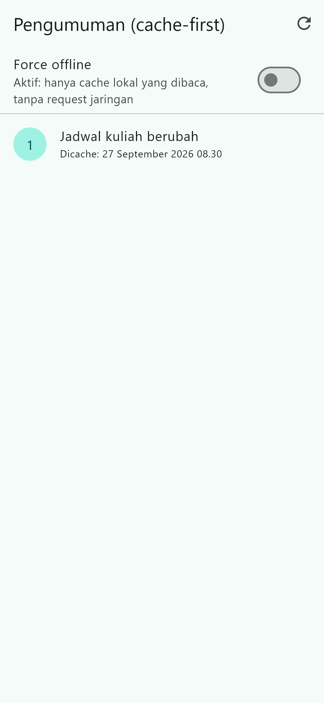
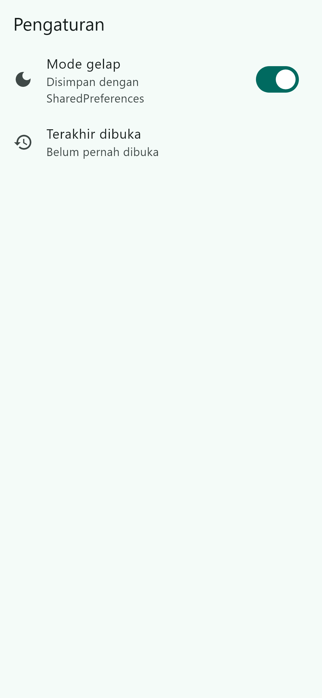

# Tujuan
- menjelaskan prinsip SOLID dan separation of concerns dengan contoh kode Flutter;
- membedakan struktur feature-first vs layer-first beserta trade-off-nya;
- menjelaskan tiga layer (presentation, domain, data) dan aturan dependensi (dependensi mengarah ke dalam);
- membedakan entity vs model serta peran repository, use case, dan dependency injection;
- merefactor project Minggu 5/6 menjadi struktur feature-first yang terpisah layer-nya;
- menguji use case dengan repository palsu tanpa database atau jaringan sungguhan.


# Fitur Utama
### SOLID dalam satu contoh Flutter

|Prinsip|Arti praktis|Gejala pelanggaran di Flutter|
|---|---|---|
|**S**ingle Responsibility|Satu kelas punya satu alasan berubah|Widget 400 baris yang sekaligus fetch API, parsing JSON, dan formatting tanggal|
|**O**pen/Closed|Tambah perilaku lewat ekstensi, bukan edit kode lama|Setiap sumber data baru memaksa edit widget yang sudah jalan|
|**L**iskov Substitution|Pengganti harus bisa menggantikan aslinya tanpa merusak|Repository palsu untuk test melempar error yang tak pernah dilempar repository asli|
|**I**nterface Segregation|Jangan paksa klien bergantung pada yang tak dipakai|Satu interface raksasa `AppRepository` untuk auth + notes + push sekaligus|
|**D**ependency Inversion|Bergantung pada abstraksi, bukan concretion|Notifier memanggil `Dio` / `sqflite` langsung alih-alih repository|

### Tiga layer dan aturan dependensi

```
presentation (widget, page, notifier, wiring provider)
      |
      v  bergantung ke
domain (entity, repository interface, use case, Failure)
      ^
      |  diimplementasikan oleh
data (model + mapping, repository impl, SQLite/API, SharedPreferences)
```

**Aturan emas (dependency rule):** dependensi hanya mengarah ke dalam. `domain` tidak tahu apa pun tentang Flutter, Dio, atau SQLite — sehingga logika bisnis bisa diunit-test murni.

### Feature-first vs layer-first

|Struktur|Bentuk|Kapan dipakai|
|---|---|---|
|`feature-first`|`lib/features/notes/{data,domain,presentation}`|Project multi-fitur (pilihan codelab ini): satu fitur bisa dipahami/dihapus tanpa menyentuh fitur lain|
|`layer-first`|`lib/{data,domain,presentation}` global|Project kecil satu fitur; cepat tapi berantakan saat fitur bertambah|

### Kosakata peran
- **Entity:** objek bisnis murni (tanpa `toMap/fromMap/toJson`). Hidup di `domain`.
- **Model:** representasi data luar (JSON/SQLite) + mapping ke entity. Hidup di `data`.
- **Repository interface:** kontrak yang dibutuhkan domain. Hidup di `domain`.
- **Repository impl:** cara memenuhi kontrak memakai Dio/SQLite. Hidup di `data`.
- **Use case:** satu operasi bisnis. Hidup di `domain`, dipanggil presentation.
- **DI:** penyuntikan dependensi lewat provider Riverpod. Widget tidak pernah `new Repository()` sendiri.

**Bukan sekadar pindah folder.** Memindahkan file tanpa memutus dependensi terlarang (widget → Dio, notifier → SQLite) bukan Clean Architecture. Yang dinilai adalah arah panah dependensi.


# Diagram Layer + Arah Dependensi (hasil refactor)
```
lib/
├── core/                              # lintas fitur, tidak bergantung ke fitur
│   ├── failures.dart                  # Failure + FailureException (Dart murni)
│   ├── format.dart                    # fungsi murni formatting tanggal
│   └── widgets/status_views.dart      # ErrorView, EmptyView
├── features/
│   ├── notes/
│   │   ├── domain/                    # TIDAK ADA import Flutter/Dio/SQLite
│   │   │   ├── entities/note.dart
│   │   │   ├── repositories/note_repository.dart        # interface
│   │   │   └── usecases/{get_notes,add_note,delete_note,sync_notes}.dart
│   │   ├── data/                      # satu-satunya yang boleh tahu SQLite
│   │   │   ├── models/note_model.dart                  # mapping di sini
│   │   │   ├── datasources/notes_database.dart
│   │   │   └── repositories/note_repository_impl.dart
│   │   └── presentation/               # TIDAK ADA SQL/Dio/jsonDecode
│   │       ├── providers/notes_providers.dart           # wiring DI + notifier
│   │       ├── pages/{notes_page,note_detail_page}.dart
│   │       └── widgets/note_tile.dart
│   ├── announcements/                 # fitur kedua, pola sama
│   │   ├── domain/{entities,repositories,usecases}
│   │   ├── data/{models,datasources,repositories}       # AnnouncementApi (Dio)
│   │   └── presentation/{providers,pages}
│   └── settings/                      # fitur ketiga (SharedPreferences)
│       ├── domain/{entities,repositories,usecases}
│       ├── data/repositories
│       └── presentation/{providers,pages}
├── routes.dart
└── main.dart                           # composition root (router + tema)
```


# Tech Stack
- Flutter / Dart
- `flutter_riverpod` (state management + DI, tanpa package DI tambahan)
- `sqflite` + `path` (SQLite di data layer)
- `shared_preferences` (preferensi di data layer)
- `dio` (HTTP di data layer, dibungkus `AnnouncementApi`)
- `go_router` (rute)


# Cara Menjalankan
Project berada pada folder `clean_notes` (refactor dari `week5_offline_notes`).

1. Masuk ke folder project.
`cd clean_notes`
2. Ambil dependency.
`flutter pub get`
3. Jalankan aplikasi (mode debug, bukan hot reload setelah menambah plugin).
`flutter run`
4. Menjalankan test.
`flutter test`
5. Cek kualitas kode.
`flutter analyze`

Regenerasi screenshot (golden test):
`$env:GEN_SCREENSHOTS=1; flutter test --update-goldens test/screenshots_test.dart`


# Hasil
- Memahami prinsip SOLID dan gejalanya di kode Flutter nyata.
- Mampu memilih struktur feature-first dan alasannya (bukan sekadar layer-first).
- Mampu memecah satu fitur lama menjadi domain/data/presentation tanpa merusak perilakunya.
- Mampu menerapkan dependency rule: domain bebas Flutter, presentation bebas data mentah.
- Mampu membuat use case yang punya alasan bisnis jelas (bukan use case per CRUD tanpa aturan).
- Mampu menguji use case dengan repository palsu tanpa SQLite/Dio/jaringan — 13 test lulus.
- `flutter analyze` bersih dan tiga grep verifikasi nol hasil.


# Tugas (Mini Project / Industry Challenge)
Refactor project Minggu 5 menjadi **Clean Architecture feature-first** pada folder `07-week-7-clean-architecture/clean_notes`.

1. [x] Fitur penuh terpisah: `notes` (entity, repository interface, use case, Failure) + `data` (model, repository impl) + `presentation` (provider wiring, pages). Fitur kedua `announcements` dan ketiga `settings` memakai pola yang sama — tidak ada fitur yang "kotor".
2. [x] Dependency rule terbukti: hasil tiga grep sterilitas ada di bawah.
3. [x] Behavior identik: screenshot before/after tiap fitur di folder `screenshots/`.
4. [x] Minimal 2 test lulus (use case sukses + failure dengan repository palsu) — total 13 test.
5. [x] AI Challenge dikerjakan dan didokumentasikan di `docs/ai-challenge-clean-architecture.md`.
6. [x] Struktur `lib/`, `test/`, `docs/`, `README.md`, dan `screenshots/`.

## Pemetaan File ke Layer (Praktikum 1)
|File lama (Minggu 5)|Layer saat ini|Masalah|Tujuan barunya|
|---|---|---|---|
|`lib/data/local/note.dart`|data (+entitas tercampur)|Entity masih punya `toMap/fromMap`|`domain/entities/note.dart` (murni) + `data/models/note_model.dart` (mapping)|
|`lib/data/local/db.dart`|data|OK, tapi dipakai lintas fitur|Pindah ke `features/notes/data/datasources/`|
|`lib/data/repositories/note_repository.dart`|data (+kontrak tercampur)|Interface dan implementasi satu kelas|Interface di `domain/`, impl di `data/`|
|`lib/data/providers.dart`|presentation (state)|Semua provider satu file, mencampur fitur|Pecah per fitur di folder `presentation/providers/`|
|`lib/data/prefs.dart`|data (+kontrak tercampur)|Sama seperti repository catatan|Pecah: entity + interface + impl + 1 use case|
|`lib/pages/notes_page.dart`|presentation|Mengambil data langsung dari provider global|Jadi `features/notes/presentation/pages/`|
|`lib/widgets/note_tile.dart`|presentation|OK, tapi di root|Jadi `features/notes/presentation/widgets/`|
|`lib/data/sync.dart`|data (+logika bisnis)|Aturan sync bercampur dengan detail cache|Aturan sync jadi `domain/usecases/sync_notes.dart`|
|`lib/pages/cached_posts_page.dart`|presentation|Jadi fitur `announcements` (bukan utilitas)|`features/announcements/`|

## Tiga Pelanggaran Klasik (Praktikum 2)
Pencarian dijalankan **sungguhan** di project Minggu 5 dan 6. Path `lib/providers` disesuaikan ke `lib/data/providers.dart` karena itu lokasi aslinya di project Minggu 5. Output lengkap ada di `docs/grep-verifikasi.md`.

- Before `week5_offline_notes`: pencarian (1) jaringan/db di pages+widgets → NOL HASIL; (2) logika bisnis di build() → NOL HASIL; (3) DI bocor → **4 TEMUAN** (`providers.dart:9`, `providers.dart:38`, `note_repository.dart:10`, `auth_repository.dart:11`).
- Before `campus_notify`: (1) dan (2) NOL HASIL; (3) → **1 TEMUAN** (`auth_provider.dart:10`).
- Temuan nyata di luar grep: `Note` punya `toMap`/`fromMap` (entity tercampur mapping), `NoteRepository`/`AuthRepository` mencampur kontrak + implementasi, dan kegagalan masih `throw Exception` mentah tanpa tipe `Failure`.

## Hasil Verifikasi Tiga Grep (setelah refactor)
**1. Presentation steril dari data mentah** → **NOL HASIL ✅**
```
Dio\(|openDatabase|getDatabasesPath|FlutterSecureStorage|SharedPreferences\.getInstance|jsonDecode
lib/features/*/presentation
```
**2. Domain steril dari framework & package** → **NOL HASIL ✅**
```
import 'package:flutter|import 'package:dio|import 'package:sqflite|import 'package:firebase
lib/features/*/domain
```
**3. Static analysis + test**
```
flutter analyze  -> No issues found
flutter test     -> All tests passed (13 test)
```


# AI Challenge
Prompt, tabel **usulan AI vs keputusan final**, daftar bagian yang saya tandai over-engineering, dan hasil verifikasi grep ada di `docs/ai-challenge-clean-architecture.md`.

Ringkasan keputusan:
|Usulan AI|Keputusan|Alasan|
|---|---|---|
|Pisah entity vs model|✅ Diterima|Entity bisnis tidak boleh bergantung format penyimpanan|
|Interface di domain, impl di data|✅ Diterima|Kontrak dibutuhkan domain, implementasi detail tidak|
|Use case untuk setiap CRUD|⚠️ Sebagian|Dibuat hanya untuk operasi yang punya aturan bisnis (judul wajib, alur sync)|
|Repository interface generik|❌ Ditolak|Over-abstraction; kontrak spesifik per fitur lebih jelas|
|Tambah `fpdart` untuk `Either`|❌ Ditolak|Pakai Dart record, pola kontrak sama tanpa dependency baru|
|Tambah `get_it` untuk DI|❌ Ditolak|Provider Riverpod sudah cukup|


# Refactoring Challenge
1. [x] Pola yang sama diterapkan ke fitur kedua (`announcements`) dan ketiga (`settings`): entity + repository interface + impl + use case + provider wiring.
2. [x] Formatting tanggal diekstrak ke fungsi murni `lib/core/format.dart` (diuji tanpa widget di `format_and_model_test.dart`).
3. [x] Exception mentah diubah menjadi `Failure` yang ramah pengguna sebelum mencapai UI (`core/failures.dart` + `FailureException`); UI hanya menerima `message`.


# Checklist Verifikasi Mandiri
- [x] Tiga grep sterilitas (presentation & domain) nol hasil.
- [x] Interface di domain, implementasi di data, mapping hanya di model.
- [x] Widget tidak menginstansiasi repository; semua lewat provider.
- [x] Aplikasi berjalan identik sebelum/sesudah refactor (bukti screenshot before/after).
- [x] `flutter analyze` bersih dan semua test lulus (13 test).
- [x] Hasil AI diverifikasi dan didokumentasikan pada folder `docs/`.


# Refleksi
- **Mengapa interface repository harus tinggal di domain, bukan di data? Apa yang rusak bila dibalik?** Domain butuh tahu *apa* yang bisa dilakukan (kontrak), bukan *bagaimana* melakukannya. Kalau interface-nya di data, maka domain meng-import data, dan panah dependensi berbalik ke luar: logika bisnis jadi bergantung pada SQLite/Dio, mustahil diunit-test tanpa database, dan mengganti sumber data berarti mengubah seluruh domain. Kebalikannya: data mengimplementasikan kontrak domain, jadi satu domain bisa punya banyak data source (SQLite, cache, API) tanpa berubah.

- **Kapan use case benar-benar dibutuhkan, dan kapan repository langsung ke notifier sudah cukup?** Use case wajib saat operasinya punya aturan bisnis atau menggabungkan lebih dari satu repository (mis. validasi judul kosong, atau alur hitung-dirty → upload → tandai-clean). Untuk CRUD satu-baris tanpa aturan apa pun, repository langsung dari notifier sudah cukup — membuat use case untuk itu hanya menambah file tanpa menambah nilai (over-engineering), dan menambah beban navigasi kode.

- **Apa biaya over-engineering (use case per CRUD satu-baris) bagi tim kecil? Kapan biayanya sepadan?** Biayanya nyata: file harus lebih banyak, onboarding lebih lama, dan setiap perubahan harus menyentuh banyak layer, sementara benefits (testability, flexiblity) belum tentu terpakai. Untuk tim kecil, biaya ini sepadan bila aplikasi sudah punya banyak sumber data, butuh banyak aturan bisnis, atau akan berkembang jadi multi-fitur.

- **Bagian mana dari usulan AI yang Anda tolak atau sederhanakan, dan mengapa?** Saya menolak penambahan `fpdart` dan `get_it` (dependency baru untuk masalah yang sudah bisa diselesaikan dengan Dart record dan provider Riverpod), menolak repository interface generik, dan menyederhanakan jumlah use case menjadi hanya yang punya aturan bisnis. Saya juga menolak usulan membuat fitur `push` baru karena codelab ini demanding refactor, bukan menambah fitur.


# Referensi
- [Slide Week 7: Clean Architecture](../00-slides/Week_07_Clean_Architecture.html)
- [Flutter: App architecture guide](https://docs.flutter.dev/app-architecture/guide)
- [The Clean Architecture (Robert C. Martin)](https://blog.cleancoder.com/uncle-bob/2012/08/13/the-clean-architecture.html)
- Riverpod: [Providers & dependency injection](https://riverpod.dev/docs/concepts/providers)
- [Dart: Records (return ganda sukses/gagal)](https://dart.dev/language/records)
- [fpdart package (alternatif Either)](https://pub.dev/packages/fpdart)
- [GoRouter: redirect & deep linking](https://go_router.dev/)
- [Learn Dart in Y Minutes](https://learnxinyminutes.com/dart/)


# Screenshot
## Before (Minggu 5 — `week5_offline_notes`)

Daftar catatan


Daftar kosong


Error state


Detail catatan


Pengaturan


## After (Minggu 7 — `clean_notes`)

Daftar catatan


Daftar kosong


Detail catatan


Pengumuman (cache-first)


Pengaturan

