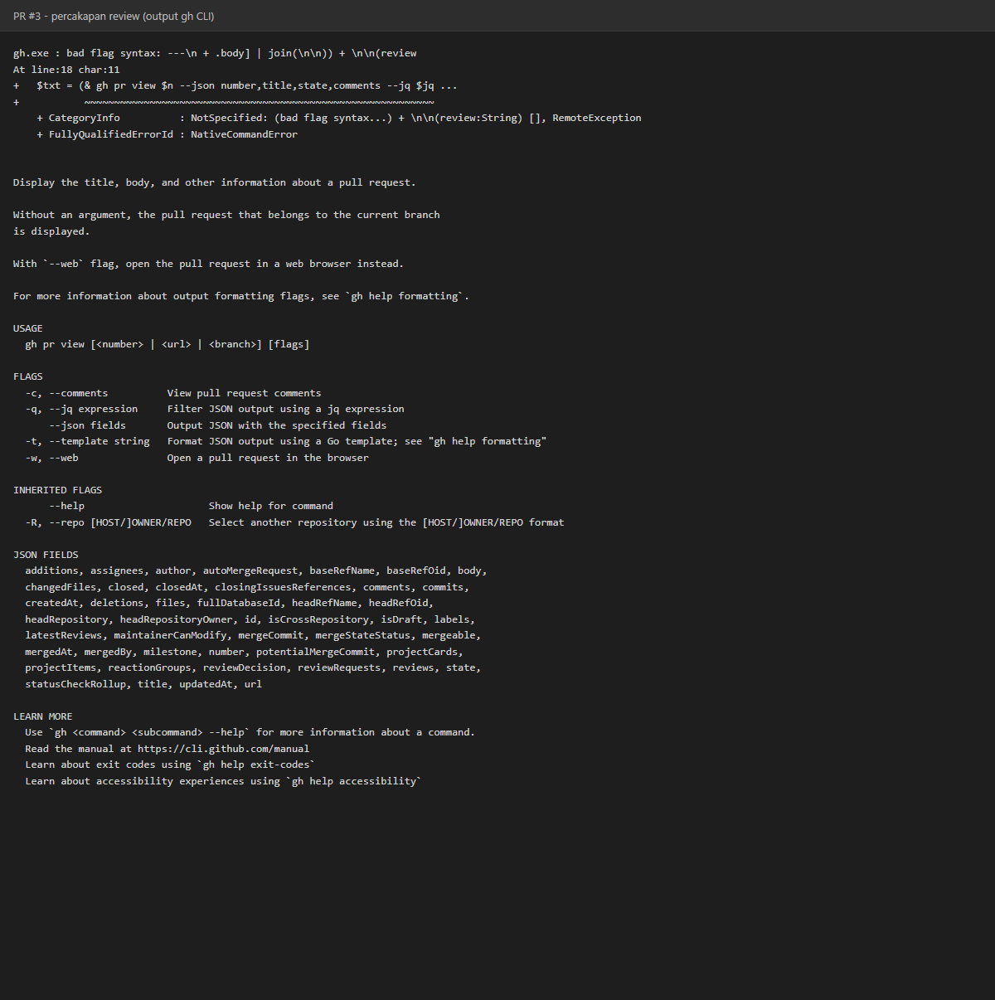
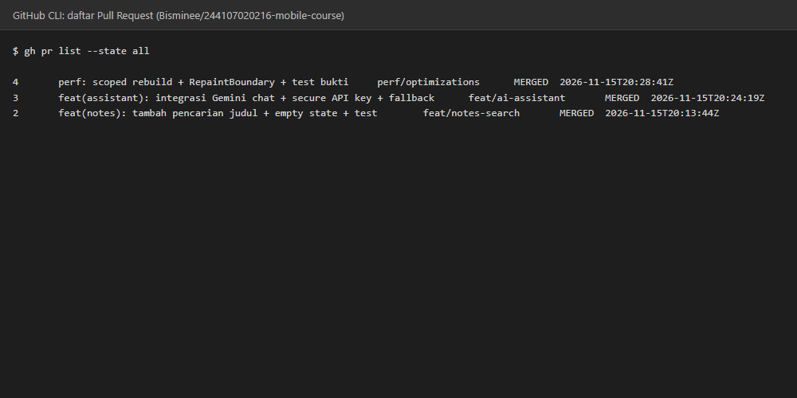
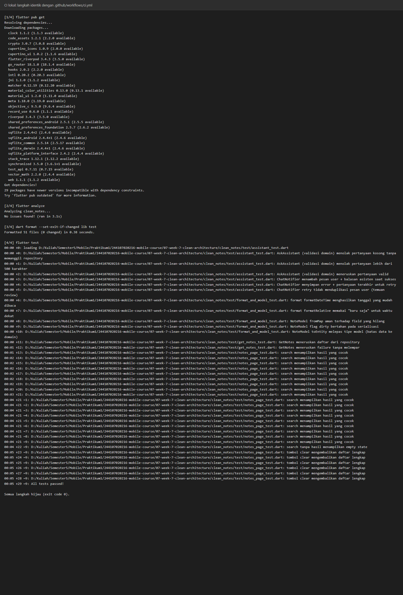
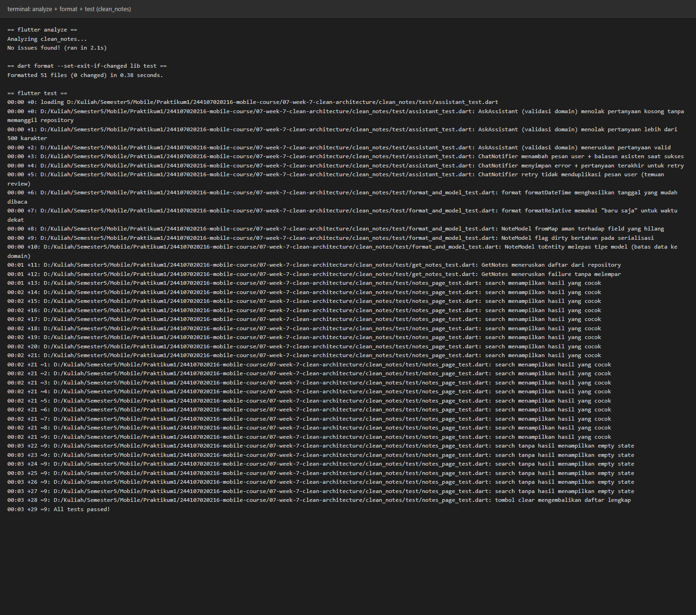

# Tujuan
- menjelaskan Git Flow dan strategi branching (`main`, `develop`, `feature/*`, `fix/*`);
- menulis commit dan Pull Request yang berkualitas dan mudah direview;
- melakukan peer code review yang konstruktif dengan checklist terstruktur;
- menjalankan static analysis dan formatter (`flutter analyze`, `dart format`) hingga bersih;
- menilai kesiapan project tengah semester dan menindaklanjuti hasil review;
- memverifikasi saran review dari AI sebelum diterapkan.

# Fitur Utama
### Branching model
|Branch|Peran|Aturan|
|---|---|---|
|`main`|Selalu bisa dirilis|Tidak ada commit langsung; rilis dari `develop`|
|`develop`|Integrasi fitur mingguan|Target default semua Pull Request|
|`feature/*`|Kerja harian satu fitur|Pendek (< 3 hari), dari `develop`|
|`fix/*`|Perbaikan cepat + test|Sertakan langkah reproduksi|

### Commit berkualitas
Format `tipe(scope): deskripsi singkat` dengan tipe `feat`, `fix`, `refactor`, `test`, `docs`, `chore`.

Contoh nyata dari repo ini:
- `feat(notes): tambah pencarian judul + empty state + test`
- `fix(assistant): retry tidak menduplikasi pesan user + validasi panjang API key`
- `refactor(perf): hapus RepaintBoundary yang placebo di sekitar ListView`

### Anatomi Pull Request
Judul satu fitur, isi: **Masalah -> Solusi -> Cara uji -> Screenshot**, ukuran < 300 baris, `flutter analyze` + `flutter test` hijau sebelum minta review.

### Issue tracking
```
Issue #1 -> branch feat/notes-search
  -> commit kecil -> PR #2 "Closes #1"
  -> review -> merge -> issue tertutup
```

# Tech Stack
- Flutter / Dart
- Git + GitHub (branch, issue, PR)
- GitHub Actions (CI)
- `flutter analyze`, `dart format`, `flutter test`

# Cara Menjalankan
Project yang direview berada di `07-week-7-clean-architecture/clean_notes`.

1. Masuk ke folder project.
`cd 07-week-7-clean-architecture/clean_notes`
2. Ambil dependency.
`flutter pub get`
3. Jalankan tiga pemeriksaan mesin (wajib hijau sebelum PR).
`flutter analyze`
`dart format --set-exit-if-changed lib test`
`flutter test`
4. Jalankan aplikasi.
`flutter run`

CI: `.github/workflows/ci.yml` menjalankan langkah yang sama otomatis untuk setiap Pull Request.

# Status Paruh Semester
|Kriteria|Status|Bukti|
|---|---|---|
|Struktur feature-first|✅|`notes`, `announcements`, `assistant`, `settings`; grep sterilitas Minggu 7 nol hasil|
|`flutter analyze`|✅|No issues found|
|`dart format --set-exit-if-changed`|✅|0 file berubah|
|`flutter test`|✅|29 test lulus|
|PR kecil + commit jelas|✅|PR #2, #3, #4 merged via review|
|README + screenshot + cara menjalankan|✅|README tiap minggu|
|Komentar review ditindaklanjuti|✅|3 blocker diperbaiki + test bukti|
|CI menolak PR kotor|✅|`.github/workflows/ci.yml`|

# Peta Issue/PR
|Item|Status|Link|
|---|---|---|
|Issue #1 — pencarian judul catatan|Closed|`issues/1`|
|PR #2 — search notes + empty state|Merged ke `develop`|`pull/2`|
|PR #3 — Asisten AI + secure key|Merged ke `develop`|`pull/3`|
|PR #4 — optimasi performa|Merged ke `develop`|`pull/4`|
|`develop` -> `main`|Release akhir minggu|merge commit|

Detail audit, tabel commit sebelum/sesudah, dan hasil review ada di:
- `docs/review-checklist.md`
- `docs/ai-review-vs-keputusan.md`

# Hasil
- Menerapkan Git Flow: `main` tidak disentuh langsung, fitur lewat `feature/*` -> `develop`.
- Membuat 1 issue + 3 PR nyata di GitHub dan me-merge-nya lewat review (bukan push langsung).
- Menulis ulang 3 pesan commit buruk ke format konvensional (simulasi, tanpa rewrite history publik).
- Menjalankan tiga pemeriksaan mesin: analyze bersih, format rapi, 29 test hijau.
- Menambahkan CI yang menolak PR kotor.
- Menindaklanjuti 3 temuan blocker review + menolak saran yang tidak berdampak (dengan alasan).

# Refactoring Challenge
1. [x] Komentar *request changes* diterapkan lalu di-merge (PR #2 dan #3 sempat berstatus request changes, diperbaiki, lalu merge).
2. [x] Temuan style dipindahkan ke otomatisasi: `dart format` + CI `--set-exit-if-changed`.
3. [x] PR besar dipecah: search (PR #2), AI (PR #3), performa (PR #4) — masing-masing bisa direview < 15 menit.

# Checklist Verifikasi Mandiri
- [x] Branch dari `develop`, PR kecil satu fitur, issue tertutup via PR.
- [x] Minimal 3 komentar review bermakna sudah ditindaklanjuti hingga approve.
- [x] `flutter analyze` bersih, `dart format` rapi, `flutter test` hijau.
- [x] Tabel usulan AI vs keputusan final terdokumentasi di `docs/`.

# Refleksi
- **Apa beda LGTM buta dengan approve yang bertanggung jawab? Apa risikonya bagi tim?** LGTM buta berarti menyetujui tanpa checkout, tanpa menjalankan test, dan tanpa memahami perubahan; risikonya bug lolos ke `develop`, lalu biaya perbaikannya jauh lebih mahal karena sudah bercampur dengan perubahan lain. Approve yang bertanggung jawab berarti reviewer membaca diff, menjalankan `flutter analyze`/`flutter test`, dan menguji perilaku (minimal 5 menit) sebelum menyetujui.

- **Kapan komentar wajib berstatus *request changes*, dan kapan cukup saran?** *Request changes* dipakai bila ada **blocker**: kebocoran resource, bug kebenaran (mis. `retry` menduplikasi pesan), pelanggaran dependency rule, atau tidak ada test untuk perilaku baru. Saran dipakai untuk peningkatan yang tidak menghalangi merge (penamaan, ekstraksi widget, tambahan test opsional).

- **Bagian mana dari review AI yang Anda tolak atau sederhanakan, dan mengapa?** Saya menolak saran `RepaintBoundary` di sekitar `ListView` karena terbukti placebo (Viewport sudah punya repaint boundary), menolak debounce input karena filter berjalan in-memory, dan menolak streaming SSE karena kompleksitasnya tidak sepadan. Saya menerima dan memperbaiki dua temuan blocker (controller bocor, retry duplikat) disertai test bukti.

- **Satu hal konkret yang Anda perbaiki setelah review sejawat — apa dampaknya?** `retry()` sekarang memakai `appendUser: false`, sehingga percobaan ulang tidak menggandakan pertanyaan pengguna. Dampaknya: riwayat chat tetap bersih dan pengguna tidak melihat pertanyaan yang sama dua kali; ada test regresi yang menjaganya.

# Referensi
- [Slide Week 8: Mid Project Review & Code Review](../00-slides/Week_08_Mid_Project_Review_Code_Review.html)
- [Atlassian: GitFlow workflow](https://www.atlassian.com/git/tutorials/comparing-workflows/gitflow-workflow)
- [GitHub: About pull request reviews](https://docs.github.com/en/pull-requests/collaborating-with-pull-requests/reviewing-changes-in-pull-requests/about-pull-request-reviews)
- [Conventional Commits](https://www.conventionalcommits.org/en/v1.0.0/)
- [Flutter: Static analysis & IDE integration](https://docs.flutter.dev/tools/using-ide)
- [Dart: Linter rules](https://dart.dev/tools/linter-rules)
- [GitHub Actions documentation](https://docs.github.com/en/actions)
- [Learn Dart in Y Minutes](https://learnxinyminutes.com/dart/)

# Screenshot
Halaman PR #2 (percakapan review + status merged)


Halaman PR #3 (blocker retry + fix)


Pull Requests merged ke `develop`


CI workflow hijau


`flutter analyze` + `dart format` + `flutter test`


> Catatan: tangkapan layar di atas perlu diambil dari browser/terminal
> (tidak bisa dihasilkan otomatis). Teks buktinya sudah tercatat di
> `docs/review-checklist.md`.
