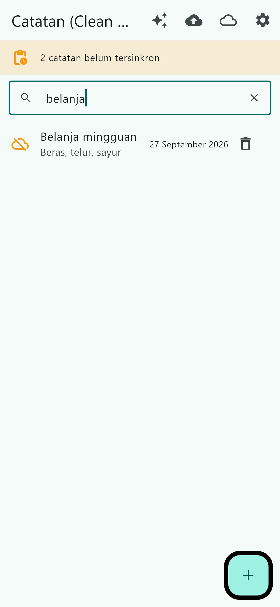
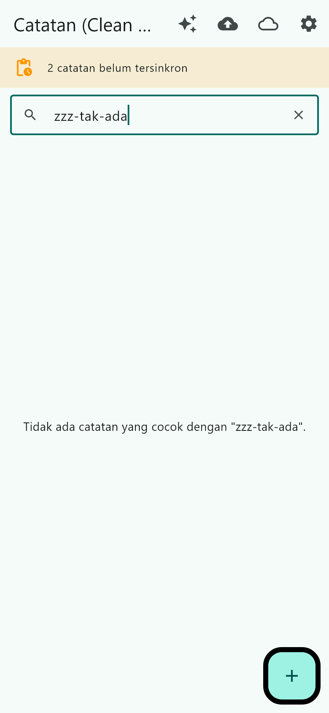

# Tujuan
- menjelaskan workflow AI-assisted development (prompt, generate, verify, test, refactor, explain);
- menulis prompt dan konteks yang efektif untuk fitur Flutter kecil;
- mengenali halusinasi dan keterbatasan AI pada kode Flutter;
- melakukan debugging dan refactoring kode hasil AI ke Clean Architecture;
- menguji kode hasil AI dengan `flutter analyze` dan test;
- mendokumentasikan prompt, hasil AI, keputusan terima/tolak, dan bukti uji di `docs/ai-log.md`.

# Fitur Utama
Fitur yang ditambahkan: **pencarian judul catatan** pada project `clean_notes`.

- Kolom pencarian di halaman Catatan (case-insensitive, trim spasi).
- Empty state khusus: `Tidak ada catatan yang cocok dengan "<query>".`
- Tombol clear untuk mengembalikan daftar lengkap.
- Filter dijalankan **use case domain murni** (`SearchNotes`), bukan di widget.
- Daftar hasil diturunkan lewat `filteredNotesProvider` (tanpa query ulang ke SQLite saat mengetik).

### Siklus yang dijalankan
```
1. Prompt (5 slot) -> 2. Generate -> 3. Verify (baca, cek API)
-> 4. Test (analyze + unit/widget) -> 5. Refactor ke Clean Architecture
-> 6. Explain (dokumentasi ini)
```

### Halusinasi/bug AI yang ditemukan
AI mengusulkan filter `title.contains(query)` di dalam widget. Dibuktikan salah dengan test: judul `'Belanja mingguan'` tidak cocok dengan query `'belanja'` (case-sensitive). Perbaikan: `toLowerCase()` + `trim()` di use case domain. Detail + bukti di `docs/ai-log.md`.

# Tech Stack
- Flutter / Dart
- `flutter_riverpod` (state + provider turunan)
- `sqflite` (data layer)
- `go_router`
- `flutter_test` (unit + widget test)

# Cara Menjalankan
Project berada di `07-week-7-clean-architecture/clean_notes`.

1. `cd 07-week-7-clean-architecture/clean_notes`
2. `flutter pub get`
3. `flutter run`
4. Uji pencarian: ketik `belanja` (hasil cocok), `zzz-tak-ada` (empty state), lalu tekan tombol clear.
5. Verifikasi mesin:
   - `flutter analyze`
   - `flutter test test/search_filter_test.dart`
   - `flutter test test/notes_page_test.dart`

# Hasil
- Menulis prompt 5 slot dengan konteks arsitektur + batas eksplisit.
- Menemukan dan membuktikan 1 bug hasil AI (case-sensitive) lewat test merah -> hijau.
- Merefactor hasil AI dari widget ke use case domain murni (dependency rule tetap).
- Menambahkan 7 test terkait pencarian (5 unit filter + 2 widget: hasil & empty state, plus clear).
- `flutter analyze` bersih, `dart format` rapi, total **29 test lulus**.
- Tabel terima/tolak saran AI terdokumentasi dengan alasan teknis.

# Refactoring Challenge
1. [x] Hasil AI > 80 baris diperkecil menjadi fungsi murni `filterNotes` + use case `SearchNotes` + provider turunan.
2. [x] Filter/search dipindah dari widget ke `domain/usecases/search_notes.dart` (murni, bisa diuji tanpa Flutter).
3. [x] Import lintas layer dihapus; `presentation` hanya memakai provider/use case, `analyze` tetap bersih.

# Checklist Verifikasi Mandiri
- [x] Prompt 5 slot + konteks di `docs/ai-log.md`.
- [x] `flutter analyze` bersih, `flutter test` hijau (29 test).
- [x] 1 temuan AI dibuktikan benar (case-sensitive) + 1 ditolak beralasan (filter di widget / `setState`).
- [x] Mampu menjelaskan tanpa membuka AI (dokumentasi + komentar kode).

# Refleksi
- **Satu halusinasi AI apa yang Anda temukan dan bagaimana membuktikannya?** AI menganggap `String.contains` cukup untuk pencarian judul. Saya membuktikannya salah dengan test yang mengharapkan query `belanja` menemukan `Belanja mingguan`; test tersebut merah pada implementasi awal. Perbaikannya `toLowerCase()` + `trim()`, dan test yang sama menjadi hijau.

- **Prompt mana yang paling membantu dan apa yang Anda ubah?** Prompt 5 slot (Peran/Konteks/Tugas/Batas/Output) paling membantu karena menyebut struktur folder dan file kontrak. Yang saya ubah: menambahkan batas "jangan panggil SQLite dari widget" dan "maks 80 baris", sehingga output lebih kecil dan mudah diverifikasi.

- **Satu refactor apa yang Anda lakukan pada kode AI?** Memindahkan filter dari `build()` widget ke `SearchNotes` di domain, lalu mengekspos hasilnya lewat `filteredNotesProvider`. Ini menghilangkan import lintas layer dan membuat filter bisa diuji tanpa widget.

- **Keputusan terima/tolak mana yang paling sulit?** Menolak `setState` untuk query pencarian. Terasa lebih sederhana untuk satu halaman, tetapi saya menolaknya karena state harus tetap berada di Riverpod agar konsisten dengan arsitektur dan mudah diuji lewat provider.

# Referensi
- [Slide Week 9: AI-Assisted Development / Vibe Coding](../00-slides/Week_09_AI_Assisted_Development_Vibe_Coding.html)
- [Flutter: Using IDEs and static analysis](https://docs.flutter.dev/tools/using-ide)
- [Dart: Linter rules](https://dart.dev/tools/linter-rules)
- [Riverpod: Getting started](https://riverpod.dev/docs/introduction/getting_started)
- [GitHub Copilot: Best practices](https://docs.github.com/en/copilot/using-github-copilot/best-practices)
- [Learn Dart in Y Minutes](https://learnxinyminutes.com/dart/)
- [Dart Language Tour](https://dart.dev/guides/language/language-tour)

# Screenshot
Hasil pencarian (`belanja`)


Empty state pencarian (`zzz-tak-ada`)

