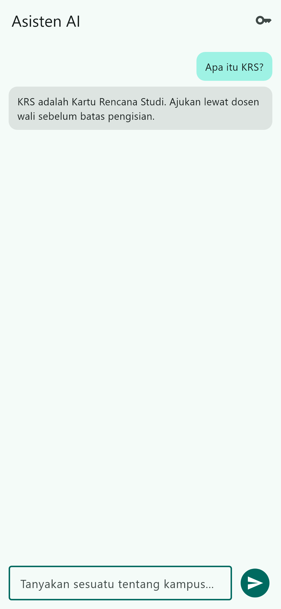
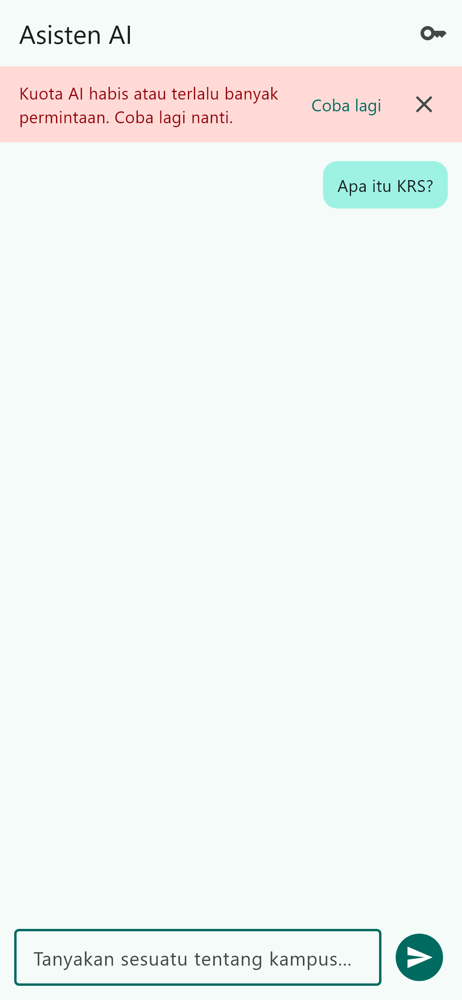

# Tujuan
- memahami konsep integrasi LLM API ke aplikasi mobile;
- merancang chat interface dengan indikator loading (dan alasan tidak memakai streaming);
- menerapkan prompt design yang aman dan efektif;
- menangani privasi, biaya, error handling, dan fallback design;
- mengevaluasi pengalaman pengguna pada fitur AI.

# Fitur Utama
Fitur **Asisten AI** pada project `clean_notes` (Gemini `generateContent`).

- Chat sederhana: kirim pertanyaan, tampilkan pesan user + balasan asisten.
- Indikator "Asisten sedang menulis..." selama request berjalan.
- Error ditangani sebagai pesan ramah + tombol **Coba lagi** (tidak crash).
- Banner "API key belum diatur" + dialog pengaturan key.
- **API key tidak pernah ada di source code**: disimpan di `flutter_secure_storage`, dikirim lewat header `x-goog-api-key` (bukan query URL), dan tidak ditampilkan ulang.
- Validasi input di domain: pertanyaan kosong atau > 500 karakter ditolak sebelum request.

### Arsitektur (feature-first)
```
lib/features/assistant/
├── domain/
│   ├── entities/chat_message.dart
│   ├── repositories/assistant_repository.dart   # kontrak
│   └── usecases/ask_assistant.dart              # validasi + aturan bisnis
├── data/
│   ├── datasources/assistant_api.dart           # Gemini + header key
│   ├── datasources/assistant_key_store.dart     # secure storage
│   └── repositories/assistant_repository_impl.dart
└── presentation/
    ├── providers/assistant_providers.dart       # DI + ChatNotifier
    └── pages/assistant_page.dart
```

### Prompt Design
| Komponen | Isi |
|---|---|
| System prompt | "Kamu asisten kampus yang ramah. Jawab dalam Bahasa Indonesia, maksimal 3 kalimat, tanpa data pribadi..." |
| User prompt | Pertanyaan pengguna (maks 500 karakter) |
| Batas | `maxOutputTokens: 256`, `temperature: 0.4` |
| Privasi | UI mengingatkan "Jangan kirim data pribadi (NIK, alamat, nomor HP)" |

### Tabel Risiko + Mitigasi
| Risiko | Mitigasi |
|---|---|
| Bocor data pengguna | Tidak mengirim data pribadi; system prompt melarang; peringatan di UI |
| API key bocor | `flutter_secure_storage` + header (bukan URL) + tidak ditampilkan/log |
| Biaya melonjak | Batas token output, batas panjang input, guard `isSending` (satu request sekaligus) |
| API error / down | `Failure` + banner + tombol Coba lagi |
| Respons tidak relevan | System prompt membatasi; pengguna bisa mengulang |
| Key typo | Validasi minimal 20 karakter di dialog |

# Tech Stack
- Flutter / Dart
- `flutter_riverpod`
- `dio` (HTTP)
- `flutter_secure_storage` (API key)
- Google Gemini API (`v1beta/models/gemini-2.0-flash:generateContent`)
- `go_router` (route `/assistant`)

# Cara Menjalankan
Project berada di `07-week-7-clean-architecture/clean_notes`.

1. `cd 07-week-7-clean-architecture/clean_notes`
2. `flutter pub get`
3. `flutter run`
4. Buka ikon **bintang** (Asisten AI) di halaman Catatan.
5. Tekan ikon **kunci** -> tempel API key Gemini -> Simpan.
   Dapatkan key di [Google AI Studio](https://ai.google.dev/). Key hanya tersimpan di perangkat.
6. Kirim pertanyaan, mis. `Apa itu KRS?`.
7. Uji fallback: hapus key atau putus internet -> muncul pesan error + Coba lagi.
8. Verifikasi mesin:
   - `flutter analyze`
   - `flutter test test/assistant_test.dart`

Catatan: API key **tidak** disertakan di repository. Tanpa key, fitur menampilkan
banner pengaturan (bukan crash).

# Hasil
- Fitur Asisten AI terintegrasi tanpa menaruh API key di source code.
- API key disimpan di secure storage dan dikirim lewat header (bukan query URL).
- 5 jenis kegagalan dipetakan ke pesan ramah: key belum diatur, key invalid, kuota habis, timeout, server error.
- Validasi input + guard anti double-send.
- `flutter analyze` bersih, `dart format` rapi, **29 test lulus**.
- Risiko privasi/biaya terdokumentasi beserta mitigasinya.

# Refleksi
- **Fitur AI mana yang Anda integrasikan dan mengapa?** Chat asisten kampus. Dipilih karena paling relevan dengan aplikasi catatan/pengumuman dan bisa didemokan tanpa kamera/mikrofon, sehingga risiko teknis (izin perangkat) lebih kecil.

- **Bagaimana Anda melindungi privasi pengguna saat menggunakan AI API?** Tidak mengirim data pribadi (system prompt melarang dan UI memperingatkan), membatasi panjang input, dan tidak menyimpan riwayat ke server. API key disimpan di secure storage dan dikirim lewat header, bukan URL.

- **Fallback apa yang Anda sediakan jika layanan AI error?** Banner pesan ramah + tombol "Coba lagi" yang mengirim ulang pertanyaan terakhir tanpa menduplikasi pesan user. Jika key belum ada, ditampilkan banner pengaturan key.

- **Satu hal yang Anda pelajari tentang UX fitur AI di mobile?** Indikator status sangat penting: tanpa "sedang menulis...", pengguna mengira tombol tidak bekerja dan menekan kirim berkali-kali. Guard `isSending` + indikator mengurangi kebingungan dan request ganda.

# Referensi
- [Slide Week 10: Integrasi Fitur AI](../00-slides/Week_10_AI_Feature_Integration.html)
- [Google Gemini AI API](https://ai.google.dev/)
- [flutter_secure_storage](https://pub.dev/packages/flutter_secure_storage)
- [http package](https://pub.dev/packages/http)
- [Riverpod: Getting started](https://riverpod.dev/docs/introduction/getting_started)
- [Learn Dart in Y Minutes](https://learnxinyminutes.com/dart/)
- [Dart Language Tour](https://dart.dev/guides/language/language-tour)

# Screenshot
Chat asisten (pertanyaan + balasan)


Fallback error (kuota habis) + tombol Coba lagi


> Kode fitur ada di `lib/features/assistant/` (salinan dari project runnable
> `07-week-7-clean-architecture/clean_notes`).
