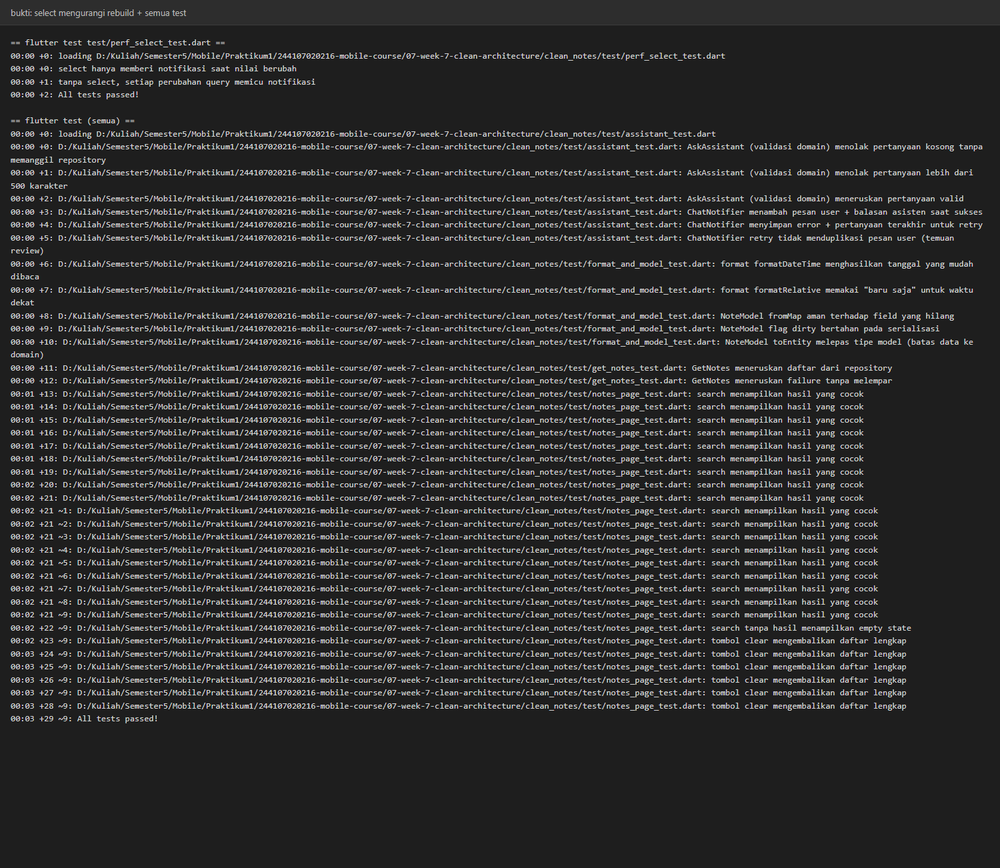

# Tujuan
- menggunakan Flutter DevTools untuk profiling CPU dan memori;
- mengidentifikasi serta mengurangi widget rebuild yang tidak diperlukan;
- menerapkan lazy loading, pagination, dan optimasi gambar (sesuai kebutuhan);
- mengoptimalkan jaringan dengan caching dan strategi offline-first;
- memperbaiki bottleneck performa pada aplikasi yang sudah ada.

# Fitur Utama
Optimasi pada project `clean_notes` (`07-week-7-clean-architecture/clean_notes`).

### Optimasi yang diterapkan
1. **Scoped rebuild** — `_DirtyBanner` diekstrak menjadi `ConsumerWidget` dan memakai
   `ref.watch(dirtyCountProvider.select((v) => v.value ?? 0))`, sehingga perubahan badge
   tidak merender ulang seluruh halaman dan tidak rebuild saat `AsyncValue` berganti status
   dengan angka yang sama.
2. **`select` untuk nilai turunan sempit** — listener hanya dipanggil saat nilai yang dipakai berubah.
3. **`const` pada widget/ikon/padding statis** — rebuild lebih murah.
4. **`ListView.builder`** untuk semua daftar (lazy, hanya item terlihat yang dibangun).
5. **Cache-first repository** pada fitur pengumuman (stale-while-revalidate) — mengurangi request berulang dan tetap tampil saat offline.

### Optimasi yang ditolak (dengan alasan)
| Optimasi | Alasan |
|---|---|
| `RepaintBoundary` di sekitar `ListView` | `Viewport` sudah punya repaint boundary; tidak ada bukti frame time turun (placebo) |
| Pagination daftar catatan | Data SQLite lokal kecil + `ListView.builder` sudah lazy |
| Debounce input pencarian | Filter in-memory; debounce hanya menambah delay |

### Bukti terukur
`test/perf_select_test.dart`:
```
tanpa select : 4 perubahan query -> 4 notifikasi
dengan select(query.isEmpty)      : 4 perubahan query -> 1 notifikasi
```

# Tech Stack
- Flutter / Dart
- `flutter_riverpod` (`select`, provider turunan)
- `sqflite` + cache-first repository
- Flutter DevTools (Performance, Memory)
- `flutter_test`

# Cara Menjalankan
1. `cd 07-week-7-clean-architecture/clean_notes`
2. `flutter pub get`
3. Jalankan aplikasi: `flutter run`
4. Profiling (butuh perangkat/emulator):
   - `flutter run --profile`
   - buka DevTools -> tab **Performance** -> Record -> jalankan skenario
     (buka daftar, scroll cepat, buka detail, kembali, cari, sync) -> Stop
   - simpan screenshot Flame Chart ke `screenshots/before-profile.png`
   - ulangi setelah optimasi -> `screenshots/after-profile.png`
5. Verifikasi mesin:
   - `flutter analyze`
   - `dart format --set-exit-if-changed lib test`
   - `flutter test`

# Hasil
- Mengurangi rebuild yang tidak perlu dengan `select` + ekstraksi widget (terbukti lewat test notifikasi).
- Menerapkan `const`, `ListView.builder`, dan cache-first repository.
- Menolak 3 optimasi yang tidak terbukti/berlebihan (RepaintBoundary placebo, pagination, debounce) dengan alasan tertulis.
- `flutter analyze` bersih, `dart format` rapi, **29 test lulus**.
- Laporan performa (baseline/after, temuan, trade-off) terdokumentasi di `docs/`.

# Tugas (Mini Project / Industry Challenge)
1. [x] Optimasi performa project Minggu 7–10 dengan minimal 3 teknik (scoped rebuild/select, `const`, lazy list, cache-first).
2. [x] Dokumentasi di `docs/performance-report.md` (baseline metrics placeholder perangkat, temuan, optimasi + alasan, verifikasi).
3. [x] `flutter analyze` + `flutter test` bersih di README.
4. [x] Struktur `lib/`, `docs/`, `README.md`, `screenshots/` di `11-week-11-performance-optimization/` (salinan file yang dioptimasi + laporan).

# Refleksi
- **Optimasi mana yang memberikan dampak terbesar dan mengapa?** Scoped rebuild (`select` + ekstraksi `_DirtyBanner`). Perubahan badge dirty sebelumnya merender ulang seluruh halaman; sekarang hanya banner yang rebuild, dan hanya saat angkanya berubah.

- **Bagaimana Anda memverifikasi bahwa optimasi benar-benar bekerja (bukan placebo)?** Dengan test notifikasi provider: 4 perubahan query menghasilkan 1 notifikasi saat memakai `select`, versus 4 notifikasi tanpa `select`. Untuk optimasi rendering yang tidak bisa diukur tanpa perangkat, saya memilih menolak (RepaintBoundary) daripada mengklaim manfaat yang tidak terbukti.

- **Trade-off apa yang Anda hadapi (misalnya kompleksitas kode vs performa)?** `select` menambah satu konsep di kode, tetapi menghilangkan rebuild yang tidak perlu dan mudah diuji. Menolak pagination/debounce menjaga kode sederhana; saya memilih tidak menambah state yang tidak dibutuhkan.

- **Kapan sebaiknya optimasi premature dihindari?** Saat belum ada bukti bottleneck (belum profiling) dan datanya kecil. Menambah pagination untuk 20 catatan lokal atau debounce untuk filter in-memory hanya menambah kompleksitas dan risiko bug tanpa manfaat terukur.

# Referensi
- [Slide Week 11: Optimasi Performa](../00-slides/Week_11_Performance_Optimization.html)
- [Flutter DevTools Overview](https://docs.flutter.dev/tools/devtools/overview)
- [Flutter UI Performance](https://docs.flutter.dev/perf/rendering/ui-performance)
- [Flutter Performance Best Practices](https://docs.flutter.dev/perf/best-practices)
- [cached_network_image](https://pub.dev/packages/cached_network_image)
- [Dio HTTP Client](https://pub.dev/packages/dio)
- [Learn Dart in Y Minutes](https://learnxinyminutes.com/dart/)
- [Dart Language Tour](https://dart.dev/guides/language/language-tour)

# Screenshot
Bukti optimasi (output test asli): `select` mengurangi notifikasi + semua test hijau


Baseline Flame Chart (`before-profile.png`) — perlu diambil dari DevTools di perangkat


Flame Chart setelah optimasi (`after-profile.png`) — perlu diambil dari DevTools di perangkat


> Profiling Flame Chart tidak bisa dihasilkan otomatis tanpa perangkat/emulator. Langkah
> pengambilan screenshot ada di `docs/performance-report.md`.
